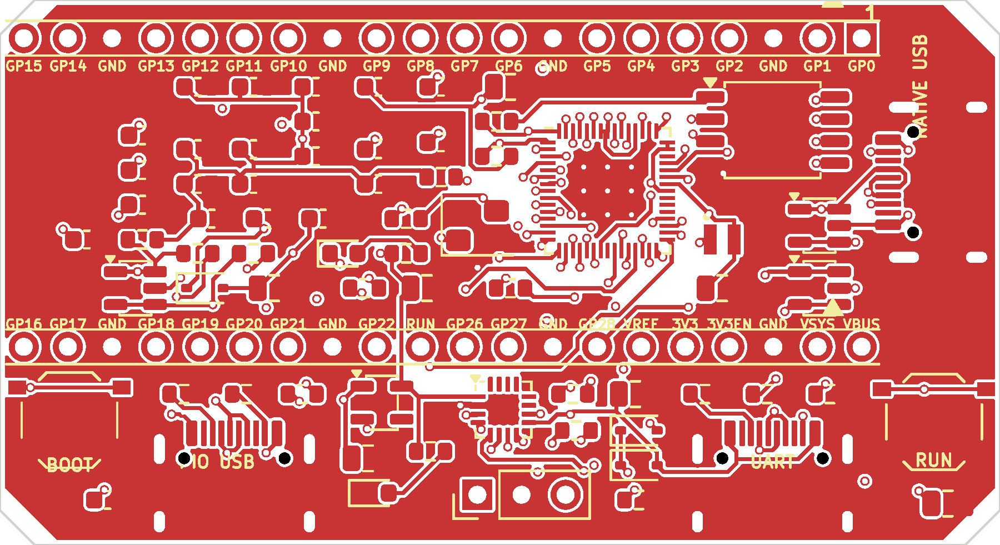

# pico2-compat — Pico 2 相当 + 3×USB Type-C + CH343P UART + PIO USB

Raspberry Pi Pico 2 相当の RP2350A ボードです。外形は
[nananek/serial-km-emulator](https://github.com/nananek/serial-km-emulator)
と同じ **57.6 × 31.4 mm（四隅 2 mm 45° カット）** で、旧型フリスクケース
と同じ外形寸法に収まります。

Pico 2 との違いは次のとおりです。

- Pico の micro-B を **USB Type-C** に変更（RP2350 のネイティブ USB）
- **GPIO 40 ピンを Pico と同一配置**（2.54 mm ピッチ、17.78 mm 列間）
- **BOOT と RUN の独立ボタン**
- **UART0 を CH343P 経由の Type-C** に接続（最大 6 Mbps）
- **PIO USB 用 Type-C**（GP12 = D+、GP13 = D-）
- 3.3 V は AP2112K、RP2350 内蔵の 1.1 V レギュレータを使用



## 仕様

| 項目 | 内容 |
| --- | --- |
| 基板 | 57.6 × 31.4 mm、t1.6 mm、4 層、四隅 2 mm 45° カット |
| MCU | RP2350A（QFN-60、7 × 7 mm） |
| フラッシュ | W25Q32JVSSIQ（4 MB、SOIC-8 208 mil） |
| 水晶 | 12 MHz（ABM8-272-T3、3225） |
| レギュレータ | AP2112K-3.3（600 mA、VSYS 3.8〜5.5 V） |
| ネイティブ USB | Type-C、USB 2.0 Full Speed、27 Ω 直列、USBLC6 ESD |
| UART | CH343P、Type-C、UART0（GP0/GP1）、3.3 V I/O、最大 6 Mbps |
| PIO USB | Type-C、GP12 = D+、GP13 = D-、22 Ω 直列、1.5 kΩ D+ プルアップ |
| GPIO | Pico 互換 2×20（1〜20 ピン / 21〜40 ピン）、2.54 mm ピッチ、17.78 mm 列間 |
| ボタン | BOOT（QSPI_SS を 1 kΩ で GND）、RUN（1 kΩ 経由で GND） |
| デバッグ | J4 1×3 ピンヘッダ（SWCLK / GND / SWDIO、未実装） |
| 電源 | 3 ポートの VBUS を BAT54WS でダイオード OR → VSYS |
| 実装 | 表面実装のみ（Type-C のシェル固定タブは THT） |

## Pico 互換ピン配置

基板を USB 側から見て、ピン 1 が USB 端の GP0 です。Pico と同じく、
1〜20 ピンが一方の列、21〜40 ピンがもう一方の列に並びます。
2.54 mm ピッチ、列間 17.78 mm（0.7 インチ）です。

| ピン | 名称 | ピン | 名称 | ピン | 名称 | ピン | 名称 |
| --- | --- | --- | --- | --- | --- | --- | --- |
| 1 | GP0 / UART0 TX | 11 | GP8 | 21 | GP16 | 31 | GP26 / ADC0 |
| 2 | GP1 / UART0 RX | 12 | GP9 | 22 | GP17 | 32 | GP27 / ADC1 |
| 3 | GND | 13 | GND | 23 | GND | 33 | GND |
| 4 | GP2 | 14 | GP10 | 24 | GP18 | 34 | GP28 / ADC2 |
| 5 | GP3 | 15 | GP11 | 25 | GP19 | 35 | ADC_VREF |
| 6 | GP4 | 16 | GP12 / PIO D+ | 26 | GP20 | 36 | 3V3 |
| 7 | GP5 | 17 | GP13 / PIO D- | 27 | GP21 | 37 | 3V3_EN |
| 8 | GND | 18 | GND | 28 | GND | 38 | GND |
| 9 | GP6 | 19 | GP14 | 29 | GP22 | 39 | VSYS |
| 10 | GP7 | 20 | GP15 | 30 | RUN | 40 | VBUS |

Pico 2 でヘッダに出ていない GP23〜GP25、GP29 は、本基板でもヘッダには
出していません。SWD は J4（未実装）に引き出しています。

## USB ポート

3 つとも **デバイス側（CC に 5.1 kΩ の Rd）** です。ホスト PC とは
C-to-C でも C-to-A でも接続できます。充電器は接続しないでください。

### J1: ネイティブ USB（右小口）

RP2350 の USB_DP / USB_DM（ピン 52 / 51）を 27 Ω で J1 に接続しています。
USBLC6 で ESD 保護しています。Pico と同じく、このポートの VBUS は
ヘッダの 40 ピン（VBUS）にも出ています。

### J3: UART（下長辺・右側）

CH343P の UD+ / UD- を J3 に直結しています。CH343 のデータシートで
「UD+/UD- に直列抵抗を入れてはいけない」と指定されているため、直列抵抗は
ありません。CH343P の VIO は 3.3 V、VDD5 は VSYS（約 4.7 V）です。
UART 側は 3.3 V I/O なので、RP2350 とレベル変換なしで接続できます。

```
GP0 (TX, pin 1) ──→ CH343P RXD (pin 5)
GP1 (RX, pin 2) ←── CH343P TXD (pin 4)
```

CTS/RTS は未接続です。6 Mbps は芯線だけの短い配線で使えますが、
フロー制御が必要な用途では 2 Mbps 以下を推奨します。USB Full Speed
(12 Mbps) の実効帯域も考慮してください。

Linux では `/dev/ttyUSB0` として見えます。CH343P は WCH の VID/PID で
認識され、Linux の `ch341` ドライバで動作します。

### J2: PIO USB（下長辺・左側）

GP12 を D+、GP13 を D- にしています。22 Ω の直列抵抗、USBLC6、
1.5 kΩ の D+ プルアップを実装しています。Type-C の CC は 5.1 kΩ の
Rd なので、このポートは **デバイス専用** です。Pico-PIO-USB を使う場合は
`pin_dp = 12`、`pinout = PIO_USB_PINOUT_DPDM`（D- = 13）に設定してください。
1.5 kΩ プルアップは基板上で固定されているため、ホスト用途には使えません。
GP12 を通常の GPIO として使う場合は R11（1.5 kΩ）を外してください。

## 電源

3 つの Type-C の VBUS を BAT54WS（D1〜D3）で OR して VSYS を作り、
AP2112K-3.3 で 3.3 V を作ります。どのポートからでも給電できます。

- VSYS: 3.8〜5.5 V（AP2112K のドロップアウトのため。USB 給電時は約 4.7 V）
- 3V3: 最大 600 mA（LDO の定格）
- RP2350 の 1.1 V は内蔵レギュレータ（VREG_VIN / VREG_LX / VREG_FB）と
  3.3 µH（L1）で生成
- 3V3_EN（ヘッダ 37 ピン）は 100 kΩ で VSYS にプルアップ。GND に落とすと
  3.3 V が停止します
- VBUS（ヘッダ 40 ピン）は J1 の VBUS に直結
- VSYS（ヘッダ 39 ピン）はダイオード OR 後の共通 5 V

Pico の 3V3 ピン（36）は本基板では LDO 出力です。外部から 3V3 を
逆駆動しないでください。VSYS から給電する場合も、LDO の入力範囲
（3.8 V 以上）を守ってください。バッテリー直結（3.7 V 以下）では
3.3 V が低下します。

## BOOT / RUN

- **BOOT**: QSPI_SS とフラッシュ CS の間の 0 Ω（R14）の前から 1 kΩ（R12）で
  ボタンに引き出しています。BOOT を押したままリセットすると、RP2350 の
  USB ブートローダー（BOOTSEL）に入ります。
- **RUN**: RUN ピンを 1 kΩ（R13）経由で GND に落とします。

BOOT と RUN は独立したタクトスイッチ（TS-1187A、5.1 × 5.1 mm）です。

## 基板外形とケース

外形は serial-km-emulator と同一の 57.6 × 31.4 mm、四隅 2 mm 45° カット
です。配線とグラウンドの都合で 4 層にしています。旧型フリスクケースの内寸には収まりますが、コネクタの位置が違うため
ケースの開口を変更してください。

- J2 / J3（PIO USB / UART）: 下長辺に 2 個。開口は約 30 × 5 mm
- J1（ネイティブ USB）: 右小口に 1 個。開口は約 10 × 5 mm
- BOOT / RUN: 基板の表側、左右の端。ケースに穴を開けるか、蓋を外して押します

コネクタの口は基板端から約 1.5 mm 外に出ます。USB-C プラグの
オーバーモールドがケースに当たる場合は、開口の外側を面取りしてください。

## 部品表（JLCPCB）

`fab/bom_jlcpcb.csv` が JLCPCB 用 BOM、`fab/cpl_jlcpcb.csv` が CPL です。
主な部品は次のとおりです（2026-11 時点の JLCPCB 在庫確認済み）。

| 記号 | 値 | パッケージ | LCSC | 備考 |
| --- | --- | --- | --- | --- |
| U1 | RP2350A | QFN-60 7×7 | C42411118 | 拡張部品 |
| U2 | W25Q32JVSSIQ | SOIC-8 208 mil | C179173 | 4 MB |
| U3 | CH343P | QFN-16 3×3 | C2846043 | 6 Mbps、水晶不要 |
| U4 | AP2112K-3.3 | SOT-23-5 | C51118 | 600 mA LDO |
| J1〜J3 | TYPE-C-31-M-12 | USB-C 16P | C165948 | HRO |
| D1〜D3 | BAT54WS | SOD-323 | C22629 | VBUS OR |
| D4〜D6 | USBLC6-2SC6 | SOT-23-6 | C7519 | ESD |
| Y1 | ABM8-272-T3 | 3225 4 pin | C20625731 | 12 MHz |
| L1 | 3.3 µH | 2016 | C42411119 | RP2350 1.1 V 用 |
| SW1, SW2 | TS-1187A-B-A-B | 5.1×5.1 mm | C318884 | BOOT / RUN |
| R1〜R6 | 5.1 kΩ | 0603 | C23186 | CC |
| R7, R8 | 27 Ω | 0603 | C25190 | ネイティブ USB |
| R9, R10 | 22 Ω | 0603 | C23345 | PIO USB |
| R11 | 1.5 kΩ | 0603 | C22843 | PIO D+ プルアップ |
| R12, R13, R18〜R20 | 1 kΩ | 0603 | C21190 | BOOT/RUN/LED/水晶 |
| R14 | 0 Ω | 0603 | C21189 | QSPI_SS |
| R15 | 33 Ω | 0603 | C23140 | VREG_AVDD |
| R16 | 200 Ω | 0603 | C8218 | ADC_VREF |
| R17 | 100 kΩ | 0603 | C14675 | 3V3_EN |
| C1〜C3, C7, C9 | 10 µF | 0805 | C15850 | VBUS / VSYS / 3V3 |
| C11, C13 | 4.7 µF | 0805 | C1779 | 1V1 / VREG_AVDD |
| C4〜C6, C8, C10, C12, C14〜C29 | 100 nF | 0603 | C14663 | デカップリング |
| C25, C26 | 15 pF | 0603 | C1644 | 水晶 |
| LED1, LED2 | KT-0603R | 0603 | C2286 | PWR / UART ACT |

J5A / J5B（Pico ヘッダ）と J4（SWD）は **未実装** です。BOM / CPL には
入りません。

## JLCPCB での発注

基板:

- 4 層、57.6 × 31.4 mm、t1.6 mm、FR-4、HASL、1 oz
- 内層: In1 = GND ベタ、In2 = 3V3 ベタ
- 最小配線幅/間隔 0.10/0.15 mm、ビア 0.5/0.3 mm
- 仕上げはお好みで（HASL / 鉛フリー HASL / ENIG）

実装:

- 表面のみ
- アップロードするファイル:
  - ガーバー: `fab/pico2-compat-gerbers.zip`
  - BOM: `fab/bom_jlcpcb.csv`
  - CPL: `fab/cpl_jlcpcb.csv`
- Type-C のシェル固定タブは THT 形状ですが、JLCPCB の SMT 実装部品として
  登録されています（C165948）。
- CPL の回転は KiCad → JLC の一般的な補正を入れてあります。必ず
  JLCPCB の実装プレビューで IC のピン 1 と Type-C の向きを確認してください。
- QFN（RP2350A / CH343P）は拡張部品です。手半田する場合は、センターパッド
  へのプリフォーム半田またはホットエアを使ってください。

## 再生成

KiCad 10 の `kicad-cli` と Python の `pcbnew` を使います。Docker がある場合は
`scripts/kicad.sh` 経由で実行できます。

```sh
# 回路図と配置（配線は消えるので注意）
./scripts/kicad.sh python3 scripts/gen_sch.py
./scripts/kicad.sh python3 scripts/gen_pcb.py

# ガーバー、ドリル、BOM、CPL、PDF
./scripts/kicad.sh ./scripts/export_fab.sh
```

`pico2-compat.kicad_pcb` は `scripts/gen_pcb.py` が配置と外形を作り、
`scripts/route.sh` の Freerouting で配線を入れています。配置を変えた場合は
配線をやり直してください。`scripts/finish_pcb.py` が GND ベタを追加して
フィルし、最終基板を作ります。

```sh
./scripts/route.sh          # DSN 書き出し → Freerouting → SES 取り込み
./scripts/kicad.sh python3 scripts/finish_pcb.py
```

Freerouting は [`freerouting/freerouting`](https://github.com/freerouting/freerouting)
の CLI を使います。Java 21 以上が必要です。

## 検証

GitHub Actions（`.github/workflows/ci.yml`）で次を実行します。

- ERC: 0 件
- DRC: エラー 0 件（`--severity-error`）
- ガーバー、ドリル、BOM、CPL、PDF の生成
- 生成物のアップロード

シルクの文字高やシルクとパッドのクリアランスは警告として残る場合があります。
製造には影響しませんが、気になる場合はシルクを調整してください。

## 制限事項

- U1 の DVDD（ピン 23）は rev A では未接続です。1.1 V はピン 6 / 39 と
  L1 / C11 / C12 で供給しています。追加のデカップリングが必要な場合は、
  U1.23 と C11 の 1.1 V 側を 0.1 mm ワイヤで接続してください。
- PIO USB はデバイス専用です（1.5 kΩ D+ プルアップ、CC 5.1 kΩ Rd）。
- CH343P の CTS/RTS は未接続です。
- 3.3 V は LDO のため、VSYS が 3.8 V を下回ると 3.3 V が低下します。
- Pico 2 の buck-boost のような広い VSYS 入力範囲ではありません。
- GP23〜GP25、GP29 はヘッダに出ていません（Pico と同じ）。
- SWD は J4 に引き出していますが、実装はしていません。
- ネイティブ USB の VBUS（ヘッダ 40 ピン）と VSYS（39 ピン）は Pico と
  同じ向きですが、3V3（36 ピン）を外部から逆駆動しないでください。

## ファイル構成

```
pico2-compat.kicad_pro / .kicad_sch / .kicad_pcb / .kicad_dru
lib/pico2.kicad_sym          回路図シンボル
lib/PICO2.pretty/            フットプリント
scripts/design.py            部品・ネットの単一ソース
scripts/gen_sch.py           回路図生成
scripts/gen_pcb.py           配置・外形生成
scripts/route.sh             Freerouting による配線
scripts/finish_pcb.py        GND ベタ追加・フィル
scripts/export_fab.sh        ガーバー/BOM/CPL/PDF 生成
scripts/make_jlc_files.py    JLCPCB BOM/CPL 変換
.github/workflows/ci.yml     CI
fab/                         発注用ファイル（生成物）
docs/                        基板画像・回路図 PDF
```

## ライセンス

MIT。基板の製造・実装は自己責任で行ってください。特に Type-C のシェル
固定タブ、USB の差し込み方向、ケースの開口寸法は、発注前に各自の環境で
確認してください。
